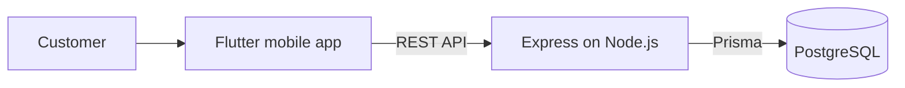

# MODA Shop

A fashion e-commerce portfolio app built with Flutter, backed by an Express REST API and PostgreSQL.

[](https://flutter.dev/)
[](https://dart.dev/)
[](https://nodejs.org/)
[](https://expressjs.com/)
[](https://www.postgresql.org/)
[](https://www.prisma.io/)

## Project Overview

MODA is a fashion e-commerce portfolio and demo application. It brings product discovery, variant selection, a persistent cart, customer accounts, and order management together in a mobile shopping experience. The project demonstrates a Flutter client working with a REST API and relational database; its catalog and business content are sample data, not a live store.

## Screenshots

The Home screen below is an actual Flutter widget-renderer capture using the demo catalog and mocked storage/authentication. See the [screenshot notes](docs/screenshots/README.md) for context.

<p align="center">
  
</p>

## Features

### Customer experience

- Browse the demo catalog by category, search, sort, and combine price, size, and category filters.
- View product details, color-specific galleries, fullscreen images, and pinch-to-zoom.
- Save recent searches and a device-local wishlist.

### Shopping

- Select available product colors and sizes, including One Size and EU footwear sizes.
- Add selected variants to a persistent cart; restored cart items are checked against current product availability and prices.
- Get server-calculated checkout totals and place Cash on Delivery orders.

### Account

- Register, log in, manage a profile and password, and use email verification and password-recovery flows when mail delivery is configured.
- Manage customer-owned shipping addresses and choose a default address.

### Order management

- View order history and saved order details.
- Recover an uncertain checkout and protect order creation against duplicate requests.
- Keep order status separate from payment status; a COD order is not marked as paid when placed.

## Tech Stack

| Area | Technologies |
| --- | --- |
| Mobile app | Flutter, Dart |
| REST API | Node.js, Express 5 |
| Data | PostgreSQL, Prisma 7 |
| Authentication | JWT, bcrypt |
| Optional email delivery | Resend; disabled in the example configuration |
| Tests | `flutter_test`, Node.js built-in test runner |

The repository documents a verified setup with Flutter 3.41.2 / Dart 3.11.0 and Node.js 22.15.0. The backend supports Node.js `^22.12.0 || >=24.0.0`; the Dart SDK constraint is `^3.11.0`.

## Architecture

The Flutter app calls the Express REST API. The API validates requests, applies account and commerce rules, and uses Prisma to read and write PostgreSQL data. Product availability, variants, prices, and checkout totals are resolved by the backend.



For more detail, see [docs/ARCHITECTURE.md](docs/ARCHITECTURE.md).

## Project Structure

```text
assets/             Bundled product photography, catalog illustrations, and branding
backend/            Express API, Prisma schema/migrations, seeds, and backend tests
docs/               Architecture, image provenance, release notes, and screenshots
lib/                Flutter app: screens, widgets, models, repositories, and services
test/               Flutter tests and synthetic fixtures
tool/               Asset utilities and repository verification scripts
```

## Getting Started

### Prerequisites

- Flutter SDK compatible with Dart `^3.11.0` and the Flutter app's supported platforms.
- Node.js `^22.12.0` or `>=24.0.0`.
- PostgreSQL and a local database for catalog and commerce operations.
- Android Studio and an Android SDK/emulator to run the Android app.

### 1. Configure the backend

Create a local PostgreSQL database and user if needed. For a new local database, the PostgreSQL commands below prompt for the role password:

```sh
createuser --host=localhost --username=postgres --pwprompt moda_user
createdb --host=localhost --username=postgres --owner=moda_user moda_shop
```

If your PostgreSQL administrator has a different name, use it in place of `postgres`. From the repository root, create a private backend environment file and install the locked dependencies:

```powershell
Copy-Item backend/.env.example backend/.env
```

On macOS/Linux:

```sh
cp backend/.env.example backend/.env
```

Edit `backend/.env` locally and set `DATABASE_URL` to your database. The example uses `moda_user` and `moda_shop`; URL-encode special characters in the password. Keep this file private and never commit it.

Then start the API from the `backend` directory:

```sh
cd backend
npm ci
npm run auth:secret
npm run prisma:generate
npm run db:migrate
npm run db:seed
npm run db:check
npm start
```

The migration and seed commands are for a database you intend to use for this app. Review the checked-in migrations and back up existing data first. The seed preserves existing prices and availability; do not reset, truncate, or drop an existing database to set up the demo.

### 2. Run the Flutter app

In a second terminal, from the repository root:

```sh
flutter pub get
flutter run --dart-define=API_BASE_URL=http://10.0.2.2:3000/api
```

Start an Android emulator first. `10.0.2.2` is the Android Emulator address for services on the development host. For a physical device, configure `API_BASE_URL` to a host address reachable from that device. This URL is app configuration, not a secret.

## Demo Information

- The catalog contains 24 sample products across five categories. Product availability, prices, shipping, and policy content are demonstration data.
- Cash on Delivery is the documented checkout method. No live online payment processing is available; disabled sandbox scaffolding does not enable real payments.
- Email delivery is disabled in the example configuration. Registration and login work locally, but interactive email verification and recovery require authorized mail-provider configuration. Checkout requires a verified account; automated tests simulate account/mail states without sending email.
- No shared demo account or customer credentials are provided. Use your own disposable local account if you configure email verification.
- Catalog and commerce operations require the local API and PostgreSQL; the app is not fully offline.

## Testing

Run Flutter checks from the repository root:

```sh
flutter analyze --no-pub
flutter test --no-pub
```

Run backend checks from `backend/` after installing dependencies and generating Prisma Client:

```sh
npm test
npm run check
npm run prisma:validate
```

The regular backend test suite uses synthetic repositories and does not require a running PostgreSQL database. Optional database/API verification commands and their prerequisites are documented in [backend/README.md](backend/README.md).

## Author

**Rawan Hossam** · [GitHub](https://github.com/rawanhossamdev)

## Image Credits and Project License

Product photography is AI-generated and disclosed in the app. See [image provenance](docs/IMAGE_PROVENANCE.md) for the documented sources, limitations, and review status. Geometric catalog artwork has its own existing CC0 notice at [assets/images/catalog/LICENSE.md](assets/images/catalog/LICENSE.md).

No project-wide software reuse license is provided, and no root `LICENSE` file is included. Third-party components and separately licensed assets retain their respective notices and terms.
