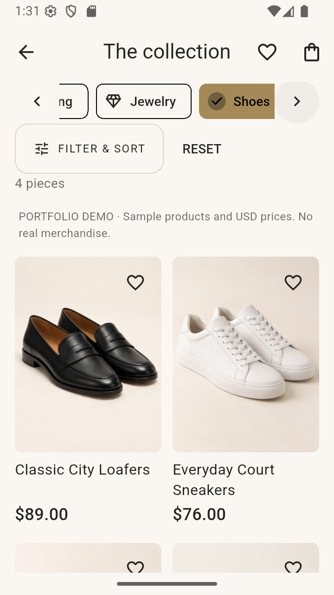
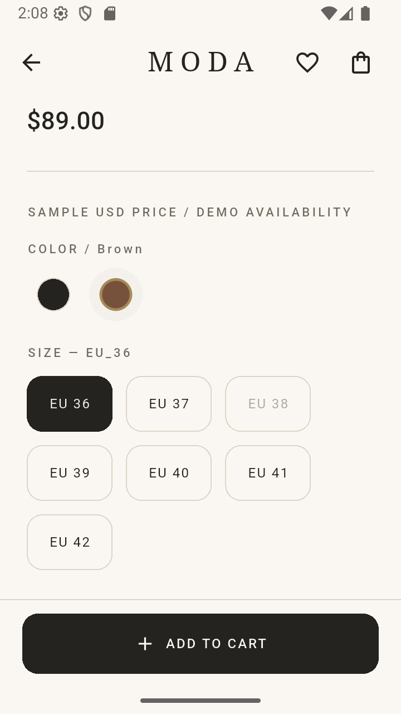

# MODA Shop

A Flutter fashion-commerce portfolio project with an Express REST API and PostgreSQL/Prisma backend. MODA pairs an ivory, charcoal and muted-gold interface with product-specific color/size variants, persistent shopping state and a transactional Cash on Delivery checkout.

**Portfolio demo, not a live store.** Products, USD prices, availability, shipping and policy text are demonstration content. No production-readiness or live online-payment support is claimed.

## Screenshots

Home is a fresh actual Flutter widget-renderer capture; the other three are Android Emulator captures. They show the demo catalog without customer names, addresses, tokens or account details.

| Home | Category browsing |
|---|---|
|  |  |
| Product gallery | Color and size selection |
|  |  |

See [screenshot notes](docs/screenshots/README.md) for capture details and image provenance.

## Features

- 24 sample products in Clothing, Bags, Shoes, Jewelry and Accessories; newest-first New Arrivals collection.
- Search, combined category/price/size filters, sorting and clearable recent searches.
- Server-defined product colors and size combinations: S/M/L, One Size and EU footwear sizes. Unavailable combinations are disabled and validated again at checkout.
- Color-specific local photo galleries, thumbnails, fullscreen paging and pinch zoom; honest missing-image fallback.
- Device-local wishlist and persistent cart. Restoration revalidates product availability, exact variants and current server prices.
- Secure session storage, account/profile/password flows and email verification/recovery support through optional Resend configuration.
- User-owned Egyptian shipping addresses, mobile validation and default address selection.
- Backend-calculated checkout totals, configurable shipping placeholder and COD orders created transactionally with idempotency keys.
- Account-isolated uncertain-checkout recovery and one-time cart settlement, order history, address/item/price/variant snapshots.
- Help content labeled as a demonstration, reduced-motion-aware startup branding and Android adaptive launcher icon.

## Stack

| Layer | Technology |
|---|---|
| Client | Flutter, Dart, Material widgets and the existing controller/repository architecture |
| Local state | flutter_secure_storage for sessions, cart/recovery and device-local preferences |
| API | Node.js, Express 5, JWT, bcrypt |
| Database | PostgreSQL, Prisma 7, pg adapter, checked-in SQL migrations |
| Optional mail | Resend HTTP delivery; disabled in the example configuration |
| Testing | flutter_test and Node's built-in test runner with injected dependencies |

Validated locally with Flutter 3.41.2 / Dart 3.11.0 and Node 22.15.0. The Dart constraint is `^3.11.0`; backend engines allow Node `^22.12.0 || >=24.0.0`. Use a compatible Flutter SDK, PostgreSQL, Git and an Android development environment reported healthy by `flutter doctor`. No platform build-version changes are needed for this project.

## Project structure

```text
lib/                   Flutter models, controllers, repositories, services, screens and widgets
assets/                Bundled product images and MODA branding
backend/src/           Express routes, validation/services, repositories and middleware
backend/prisma/        Schema, additive migrations and repeatable demo catalog seed
backend/test/          Backend unit and HTTP tests
backend/scripts/       Validation and safe local verification tools
test/                  Flutter tests and synthetic fixtures
tool/                  Asset tooling and the redacted publication audit
docs/                  Public architecture, provenance, checklist and screenshots
```

## Local setup

Clone the source repository, then work from its root. Dependency versions are pinned in `pubspec.lock` and `backend/package-lock.json`. PostgreSQL must be installed/running before database commands; the regular unit/HTTP tests do not require a running database.

### 1. Private backend configuration

PowerShell:

```powershell
cd backend
if (!(Test-Path .env)) { Copy-Item .env.example .env }
```

On macOS/Linux use `test -f .env || cp .env.example .env`. Edit your private `.env` locally: set your own PostgreSQL `DATABASE_URL`. URL-encode credentials if necessary. Never commit `.env`, paste credentials into screenshots, or put backend secrets in Flutter `--dart-define` arguments.

Keep `EMAIL_DELIVERY_ENABLED=false`, `CHECK_BREACHED_PASSWORDS=false` and `PAYMOB_ENABLED=false` for the documented local demo. `STORE_CURRENCY=USD` must match the sample catalog. `SHIPPING_FEE_CENTS=0` is a labeled free-shipping demo placeholder, not a carrier quotation. Current owner credentials are not supplied in this repository.

### 2. Database and API

For a **new local database only**, an administrator can create a dedicated role/database using the PostgreSQL CLI. These commands prompt for the new role password rather than putting it in command history:

```text
createuser --host=localhost --username=postgres --pwprompt moda_user
createdb --host=localhost --username=postgres --owner=moda_user moda_shop
```

Use your administrator role if it is not named `postgres`. Existing database owners should skip creation and point `.env` at the intended database after taking their normal backup.

From `backend/`:

```text
npm ci
npm run auth:secret
npm run prisma:generate
npm run db:migrate
npm run db:seed
npm run db:check
npm start
```

`auth:secret` writes a random JWT secret to the private `.env` only when absent and preserves an existing valid value. It never displays the value. `db:migrate` uses `prisma migrate deploy`, applying reviewed, checked-in migrations. `db:seed` creates missing demo catalog records with stable IDs, preserves existing prices/availability and owner-created collisions, and does not delete users, addresses or orders. No migrations/seeds run automatically on server startup.

**Do not run database resets, truncate tables, drop schemas or accept destructive migration prompts.** Migrations include targeted transformations of app-owned legacy demo data; review them and back up an existing database before applying them.

### 3. Flutter / Android Emulator

In another terminal, from the repository root:

```text
flutter doctor
flutter pub get
flutter emulators
flutter devices
flutter run --dart-define=API_BASE_URL=http://10.0.2.2:3000/api
```

Launch an Android Emulator in Android Studio first (or use `flutter emulators --launch <emulator-id>`). `10.0.2.2` reaches the development host from the standard Android Emulator; it is also the client's default API host. This URL is public configuration, not a secret. Physical devices require a reachable host address and deliberate local networking configuration. Changing `API_BASE_URL` requires a full app restart.

Signed-out users can browse the catalog from Login. Register a disposable local account with a unique password to exercise authenticated browsing and addresses. **Checkout requires a verified email.** With delivery disabled, registration/login work but verification/recovery cannot send codes, and unverified checkout remains gated. Use an owner-approved verified disposable account for interactive COD testing, or use the automated tests, which simulate mail/account states without sending email. No shared account credentials, seeded customers or verification bypass are provided.

For a local debug build:

```text
flutter build apk --debug
```

Output: `build/app/outputs/flutter-apk/app-debug.apk` (ignored by Git). Update an existing emulator installation with `adb install -r build/app/outputs/flutter-apk/app-debug.apk`; do not uninstall or clear data to test persistent cart behavior. SDK/JDK paths remain local to each developer.

## Checks

From the root:

```text
flutter analyze --no-pub
flutter test --no-pub
node tool/audit_publication.mjs
node --test tool/audit_publication.test.mjs
```

From `backend/` after `npm ci` and generation:

```text
npm test
npm run check
npm run prisma:validate
npm audit
```

For a configured, migrated and seeded **local development database**, optional checks are:

```text
npm run api:verify
npm run catalog:verify
npm run commerce:verify
```

`api:verify` is read-only. Catalog/commerce checks create synthetic data inside transactions and roll it back, verifying persistence/ownership/idempotency and unchanged existing counts. Do not use email-delivery scripts or enable provider integrations merely to run tests. Optional screenshot-export tests are skipped unless their explicit capture/font arguments are supplied.

## Limits and external services

- COD is the only active payment method in the documented demo. Orders start Pending / Unpaid; placing COD does not mark payment as received. Disabled Paymob sandbox scaffolding exists but is not a live-payment feature or production validation.
- Products, prices, color availability, shipping fees and Help policies are sample content; no real stock tracking, fulfillment, returns policy, carrier rates or customer-support service is claimed.
- Current catalog prices stay USD. Egyptian address fields do not imply EGP conversion.
- Resend requires the owner's authorized credentials, sender/domain and recipient rules for actual delivery. New local accounts cannot complete verified checkout with delivery off. No real mail was sent during portfolio preparation.
- Local API/PostgreSQL are needed for catalog and commerce operations; bundled images alone do not make the application fully offline.
- No admin dashboard, production deployment hardening, live carrier integration or store release is included.

## Images, attribution and license

See [image provenance](docs/IMAGE_PROVENANCE.md), [catalog manifest](assets/images/photography/PROVENANCE.json), [replacement records and exact hero prompts](assets/images/PUBLICATION_REPLACEMENTS.json), and [edit history](assets/images/photography/EDIT_HISTORY.json). Five unknown-source photos were replaced; their original bytes are excluded. The new hero and catalog use generated fictional imagery, explicitly disclosed in the UI. Provider output-rights terms are documented separately from generation; owner account/input/model, Figma and branding approvals remain necessary. No blanket clearance is claimed.

The MODA presentation was informed by the Open Fashion community UI reference; this does not grant rights to that reference's assets or design files. Its specific license remains unverified and requires owner confirmation of reference-only use/permission. This repository does not contain a redistributed Figma source file.

**Copyright © 2026 MODA Shop project owner, for owner-authored material. All rights reserved.** Source is publicly visible for portfolio review; this project grants no permission to copy, redistribute, modify, or commercially reuse its source. No software reuse license or root LICENSE is provided. This does not restrict rights under applicable law or GitHub's terms, including viewing and platform forking. See [GitHub's licensing guidance](https://docs.github.com/en/repositories/managing-your-repositorys-settings-and-features/customizing-your-repository/licensing-a-repository).

Third-party dependencies, icons, images and any files with pre-existing separate license notices retain their own rights and terms; this notice neither claims ownership of them nor revokes existing grants. In particular, geometric artwork/drawing source has an existing CC0 notice. Five unknown-source photos were replaced with documented generated-output sources; account/input/model, Figma and branding confirmations remain required. See [image provenance](docs/IMAGE_PROVENANCE.md) and the [release checklist](docs/RELEASE_CHECKLIST.md).

## Portfolio and publication

[Portfolio case study](PORTFOLIO.md) · [Architecture](docs/ARCHITECTURE.md) · [Release checklist](docs/RELEASE_CHECKLIST.md) · [Preparation report and safe publication commands](docs/PUBLICATION_REPORT.md)

The repository has not been published by this preparation pass. The owner has chosen no software reuse license. Publication still requires resolution of asset rights, a staged secrets audit and explicit final approval.
